# Base Node for Blender

[](addon/tests/libraries/README.md)
[](addon/tests/libraries/README.md#shader-groups-and-materials)
[](addon/tests/libraries/README.md#compositor-groups)

Text format (`.bn`) for Blender's node graphs. Reads and writes Geometry Nodes, shader and compositor trees as functions.

Site: https://basenode.ludopant.com/

```bn
use math (bump)

geometry graph relief(geometry: Geometry, height: Float = 0.4 in 0.0..2.0) -> Geometry {
  "Displaces vertices along Z using a radial bump"
  h = bump(length(Position()) / 3.0, 0.5, 0.2) * height
  return SetPosition(geometry, offset: CombineXYZ(z: h))
}
```

| [`examples/chrono_hud.bn`](examples/chrono_hud.bn) | [`examples/differential_growth.bn`](examples/differential_growth.bn) | [`examples/metaball_symphony.bn`](examples/metaball_symphony.bn) |
|---|---|---|
| 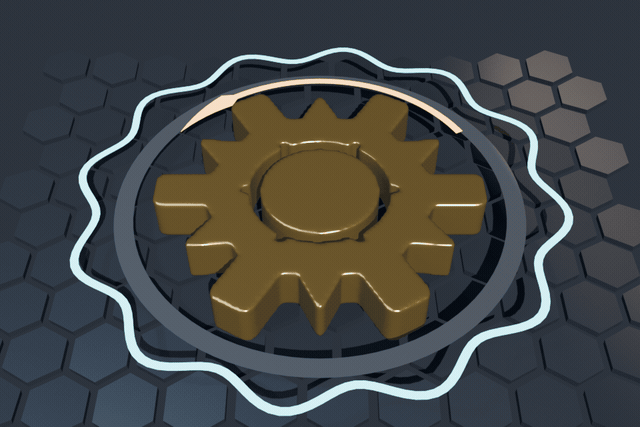 | 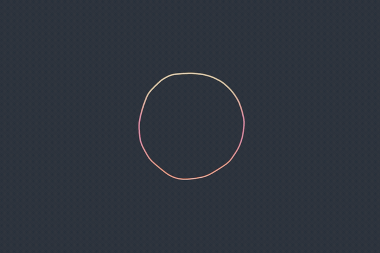 | 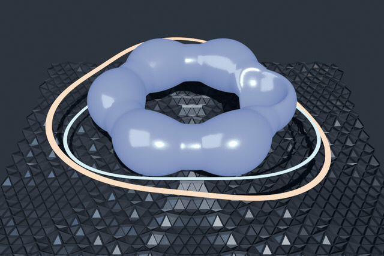 |

[`examples/erosion.bn`](examples/erosion.bn): hydraulic erosion written in `.bn`, after the virtual pipe model of Mei, Decaudin & Hu (2007). Rain, flow through 8 pipes per cell, sediment carried with the water and a thermal slide, all in one Repeat zone of a graph called like any other node:

```bn
geometry graph "eroded hills"(
    size: Float = 4.0 in 0.1..,
    resolution: Int = 128 in 2..,
    height: Float = 1.2 in 0.0..,
    iterations: Int = 50 in 0..
) -> Geometry {
  "A noise terrain on a Grid, eroded"
  hills = NoiseTexture(vector: Position(), scale: 0.6, detail: 6.0, roughness: 0.55).factor
  return Grid(size_x: size, size_y: size, vertices_x: resolution, vertices_y: resolution)
    |> SetPosition(offset: CombineXYZ(z: (hills - 0.5) * height * 2.0))
    |> erode(iterations: iterations)
    |> SetShadeSmooth()
}
```

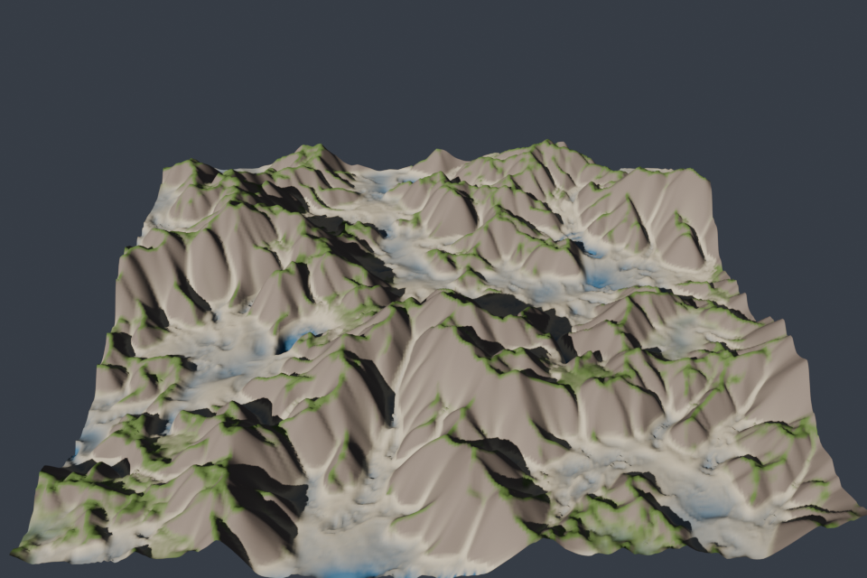

[`examples/reaction_diffusion.bn`](examples/reaction_diffusion.bn): the Gray-Scott reaction-diffusion of Pearson (1993) on a Grid with wrapped borders, a 9-point Laplacian read with Sample Index, and presets for spots, stripes, coral and mitosis in a Menu. `reaction diffusion` grows the pattern in a Repeat zone, for a still; `growing reaction diffusion` grows it in a Simulation zone, frame after frame:

```bn
geometry graph "reaction diffusion tile"(
    resolution: Int = 256 in 3..,
    preset: Menu = Coral,
    iterations: Int = 3000 in 0..
) -> Geometry {
  "A 4 x 4 Grid grown with a Gray-Scott pattern"
  return Grid(size_x: 4.0, size_y: 4.0, vertices_x: resolution, vertices_y: resolution)
    |> reaction_diffusion(preset: preset, iterations: iterations)
    |> SetShadeSmooth()
}
```

| Repeat zone, 5000 steps | Simulation zone, 100 steps per frame |
|---|---|
| 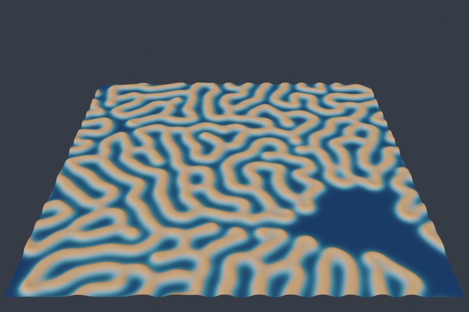 | 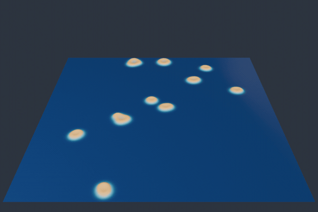 |

[`examples/differential_growth.bn`](examples/differential_growth.bn): differential growth of a closed curve, after Anders Hoff's *differential-line* and Nervous System's *Floraform* write-ups. Each step pulls every point toward its neighbours along the curve with a spring a little longer than the edges, pushes it away from the points near it (its neighbours in a triangulation of the plane by the curve, from two Fill Curve nodes, with a force falling to zero at `radius`), aligns it with the midpoint of its neighbours, then cuts the edges longer than `max length` with Subdivide Curve. `differential growth` runs the steps in a Repeat zone, for a still; `growing differential growth` in a Simulation zone, frame after frame:

```bn
geometry graph "differential growth coral"(
    size: Float = 0.4 in 0.01..,
    iterations: Int = 400 in 0..,
    "max length": Float = 0.02 in 0.0001..,
    seed: Int = 0,
    thickness: Float = 0.006 in 0.0..
) -> Geometry {
  "A circle grown into a coral outline, drawn as a tube of `thickness`"
  grown = growth_seed(size, max_length, 0.3, seed)
    |> differential_growth(iterations: iterations, max_length: max_length, radius: max_length * 2.5)
  return CurveToMesh(grown, profile_curve: CurveCircle(resolution: 8, radius: thickness))
    |> SetShadeSmooth()
}
```

| Repeat zone, 500 steps | Simulation zone, 8 steps per frame |
|---|---|
| 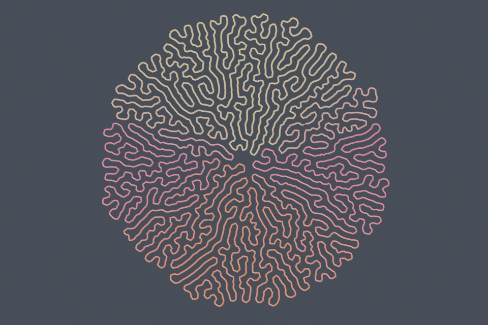 |  |

[`examples/tuple_tiles.bn`](examples/tuple_tiles.bn): tuples choose the type. No `input_type` or `data_type` is written: the 4-tuples make a Color IndexSwitch and a Color Mix, the 3-tuples a Vector Switch:

```bn
  tint = IndexSwitch(
    mod(cell, 4.0),
    (1.0, 0.3, 0.04, 1.0),
    (0.02, 0.5, 0.75, 1.0),
    (1.0, 0.72, 0.06, 1.0),
    (0.75, 0.06, 0.24, 1.0))
  shade = Mix(factor: Clamp(value: r * 0.42 - 0.1), a: tint, b: (0.04, 0.05, 0.08, 1.0))
  size = r < 1.15 ? (0.2, 0.2, 0.5) : (0.24, 0.24, 0.08)
```

| Render | The nodes it builds |
|---|---|
| 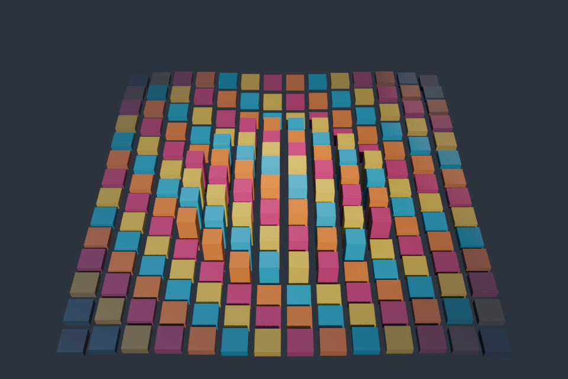 | 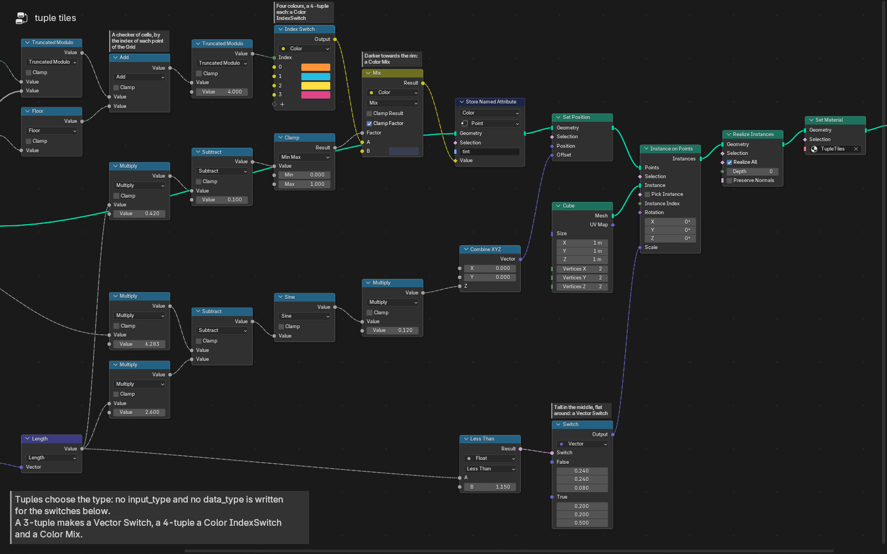 |

| `stdlib/sdf2d.bn` | `stdlib/curves2d.bn` |
|---|---|
| 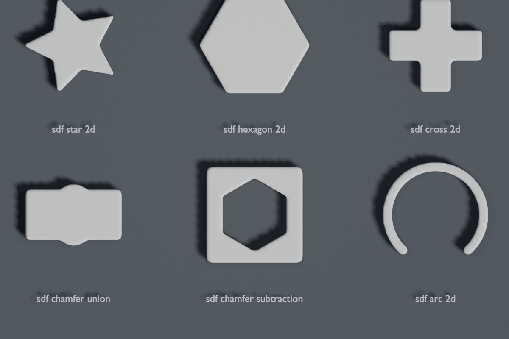 | 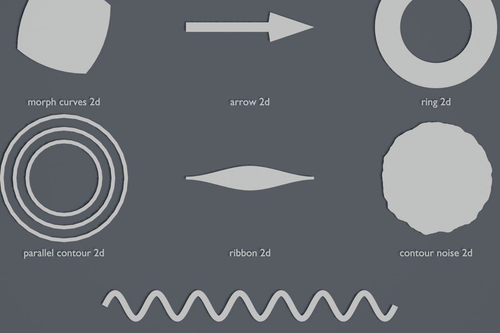 |
| **`stdlib/patterns2d.bn`** | **`stdlib/math.bn`** |
| 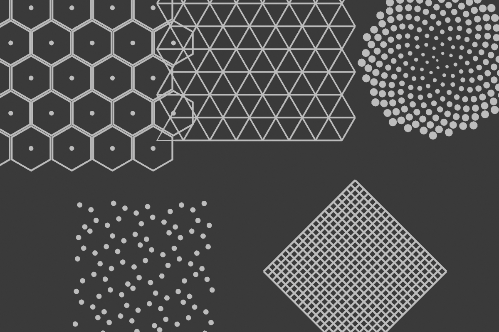 | 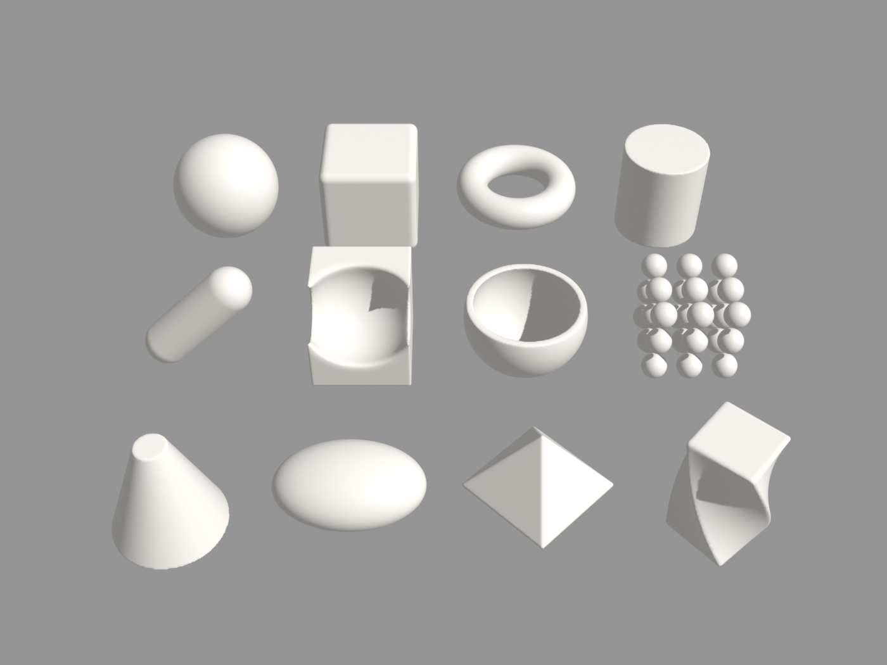 |
| **`stdlib/mask2d.bn`** (compositor, [`examples/mask2d_showcase.bn`](examples/mask2d_showcase.bn)) | **`stdlib/merge.bn`** (compositor, [`examples/merge_showcase.bn`](examples/merge_showcase.bn)) |
|  | 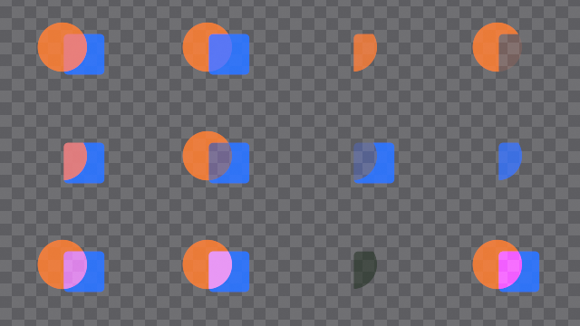 |
| **`stdlib/grade.bn`** (compositor, [`examples/grade_showcase.bn`](examples/grade_showcase.bn)) | **`stdlib/stmap.bn`** (compositor, [`examples/stmap_showcase.bn`](examples/stmap_showcase.bn)) |
| 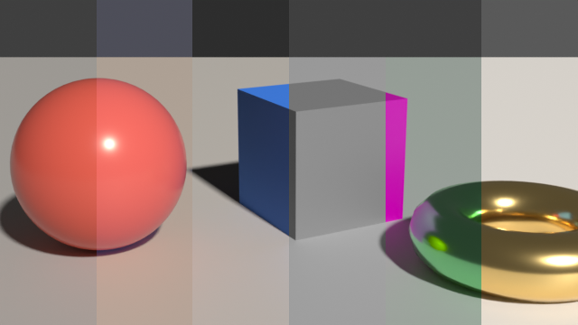 | 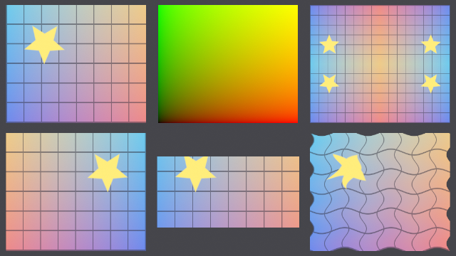 |
| **`stdlib/qc.bn`** (compositor, [`examples/qc_showcase.bn`](examples/qc_showcase.bn)) | |
| 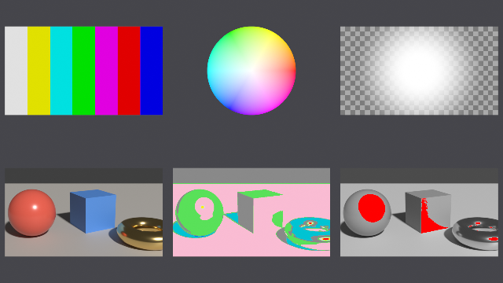 | |

More modules come in paid packs for the Base Node add-on: **Smart Materials** (live mesh maps, smart-material generators, wear made in the mesh), **Compositing Pro** (keying, glows and light wrap, film grain, render passes, 360° projections), **Ink & Engraving** (living ink, hatching and guilloché, deformation along curves), **Motion Graphics** (cloners, effectors and falloffs for motion design) and **Scatter & Biomes** (rule-based scattering with masks, spacing and avoidance, layered biomes with level of detail and camera culling).

The compositor images are rendered by [`examples/render_compositor_showcases.py`](examples/render_compositor_showcases.py):
`merge` shows A (orange disk) and B (blue square) by over, under, in, out / atop, exclusive or, stencil, mask /
plus, screen, multiply, difference; `passes`, left the render, right its passes reworked (rebuilt beauty,
P matte on the torus, relight, depth fog); `grade`, one render in six strips: as it is, grade, color correct,
saturation 0, hue shift of 90°, exposure +1 stop; `keying`, a green-screen plate made in the graph, keyed in six
tiles: the plate, IBK's alpha, the clean plate of IBK colour / the spill map, the despilled plate, the comp over a
new background; `light`, a render with emissive balls and a glowing ring in six tiles: as it is, glow, exp glow
of its highlights / anamorphic streak, a dark star wrapped by the light of the render, a glow out of that star's edges;
`stmap`, a picture made in the graph remapped by STMaps: as it is, its UV ramp, tile 2 × 2 with mirror / mirror,
reformat to 2:1 by fill, a wavy STMap; `vr360`, a Cycles equirectangular panorama of the passes scene: the latlong,
a camera view, a little planet / the 3 × 2 cubemap, a fisheye of 200°, the latlong turned half around; `grain`,
the passes render in six strips: as it is, the Kodak 5248, 5279, GT5274 and 5218 grain of Nuke's presets (three
times their intensity), large red, fine green and strong blue grain of its own;
`qc`, its test patterns: SMPTE colour bars at 75 %, the colour wheel, a soft radial over the alpha check's checker /
its checks on the render of the passes scene: as it is, its false colour by stops, its clip check half a stop over.

## Make

The targets run in this folder, or from the root of the checkout, whose Makefile runs the same ones
here. `CORE` is the checkout of the core (default `../..`). `make help` lists the targets. The common ones:

| Target | Does |
|---|---|
| `make test` | Python, Rust, the web component and Blender tests |
| `make test-libraries` | Third-party node group libraries, round-tripped |
| `make extension` | The add-on `.zip` in `dist/` (`DIST=…`) |
| `make docs` | The reference pages in `site/reference/` |
| `make backend` | The nodes the Blender it runs reports, and its catalog (`targets/`) |
| `make names FILES="a.bn b.bn"` | Formats the files, the inputs of Blender's nodes by name, without Blender |
| `make addon-lang` | Links the modules of the core into `addon/lang/`, the core the add-on embeds |

`BLENDER=/path/to/blender make test-blender` runs another Blender.

**Testing on the promised versions.** `blender` is Blender 5.2 LTS and Blender 5.3
(`promised` in [`targets/blender.json`](targets/blender.json)), and the Blender tests run on each:

```bash
make test-blender BLENDER=/path/to/blender-5.2/blender     # the add-on's tests, with that Blender
make test-libraries BLENDER=/path/to/blender-5.2/blender   # the third-party libraries, with that Blender
make test-promised BLENDERS="/path/to/blender-5.2/blender /path/to/blender-5.3/blender"   # both, with each
```

A test that needs what the Blender that runs has not is skipped and says why (a stdlib module that
promises `blender@5.3` is not built by Blender 5.2); the checks against a file written from Blender
read the file of the Blender that runs (`targets/backends/blender-<x.y>.json`). The CI runs both.

## Layout

| Path | Description |
|---|---|
| [`python/`](python/) | The Python library `base-node-blender` (`base_node_blender`: Blender's nodes, the checker, the targets, the reference pages, the commands `check`, `fmt --names` and `docs` of `base-node`), without `bpy` |
| [`rust/`](rust/) | The crate `base-node-blender`, `wasm32`-compatible: target checker and translators, the targets and the stdlib built in, what a file offers the add-on |
| [`addon/`](addon/) | Blender 5.2+ extension *Base Node* (node tree ⇄ `.bn` text, stdlib bundled) |
| [`web/`](web/) | `<bn-view>` Web Component: a `.bn` text read-only, its code and node graph (Rust → wasm), copy, enlarge, backend tags |
| [`targets/`](targets/) | Targets (`blender`, with in `blender/` the catalog of each version of Blender and its variants `gltf`, `eevee`, `cycles`; `blade`), and in `backends/` the nodes of each kind of tree read from Blender |
| [`stdlib/`](stdlib/) | Standard `.bn` modules and manifest (`math`, `sdf2d`, `curves2d`, `patterns2d`, `fillet2d`, `planar2d`, `mask2d`, `merge`, `grade`, `stmap`, `qc`) |
| [`corpus/`](corpus/) | The node groups of third-party libraries as `.bn` text, read by Blender 5.3: version 1 of the language, which a later version must read |
| [`examples/`](examples/) | Showcases, tutorials and the scripts that render them |
| [`conformance/`](conformance/) | `gltf-cases.json`: materials and what Blender's glTF exporter makes of them |
| [`site/`](site/) | The site, https://basenode.ludopant.com/ |
| [`spec/`](spec/) | [Blender](spec/blender.md) (the language as Blender reads it, its versions), [targets](spec/targets.md) (what a destination accepts, translators, `@target`), [idioms](spec/idioms.md) (ways of writing a graph, each with an example); the language is the core's [reference](../../spec/reference.md) |
| [`tools/bump.py`](tools/bump.py) | Writes the version of this folder everywhere it is written, and the version of the core it needs (`make bump`, `make bump-check`) |
| [`Cargo.toml`](Cargo.toml) | The workspace of `rust/` and `web/`, and the one path to the core's crate |
| [`.github/workflows/`](.github/workflows/) | The CI and the Pages of this folder as a repository of its own; the checkout's root runs the same jobs |

## Where the core is

This folder depends on the core of the language (`base-node`, at the root of the checkout) and reaches
it through one place per build:

| Build | The one place | Today |
|---|---|---|
| Make | `CORE` of the [`Makefile`](Makefile): every other place below is derived from it, or given it | `../..` |
| Python | the dependency `base-node==1.0.0rc7` of [`python/pyproject.toml`](python/pyproject.toml); from a checkout, the `PYTHONPATH` the Makefile exports, `$(CORE)/python` | `../../python` |
| Rust, the library and `web/` | `base-node` in `[workspace.dependencies]` of [`Cargo.toml`](Cargo.toml): a path and the version needed; the crates take it with `workspace = true` | `../../rust` |
| The add-on | `make addon-lang` links the modules of `$(CORE)/python/base_node` into `addon/lang/` (not in git), and `addon/build.sh` copies them as files into the zip | `../../python/base_node` |
| The reference pages | `make docs` gives `--core $(CORE)`: the language's pages are its `spec/` (the default of `base-node docs` is the checkout `base_node` is imported from) | `../../spec` |
| Conformance cases | none: the tests of this folder read its own (`conformance/`, `python/tests/fixtures/`) | |
| The version | [`tools/bump.py`](tools/bump.py) writes the version of the core needed in the two dependencies above, and `make bump-check` checks it is `$(CORE)`'s | |

## Targets

A target is what one destination accepts; there is one file per target in [`targets/`](targets/), and
none is defined from another ([spec](spec/targets.md)):

```text
blender             every node of Blender, by kind of tree, in every version this Base Node promises
blender@5.3         the same in one version of Blender; an LTS says so: blender@5.2-lts
blender gltf        a variant: the shader nodes Blender's glTF exporter turns into a material
blender eevee       a variant, experimental: the shader nodes EEVEE takes (blender cycles: Cycles)
blade               Blade's Pixel Nodes, with a translator from blender
```

The kind of tree is the first word of a graph (`geometry graph`, `shader graph`, `compositor graph`):
`blender` checks each graph against the nodes of its kind. A variant follows the target or one of its
versions (`blender@5.3 gltf`). On a command line, `blender@latest` and `blender@lts` name a version;
a text does not promise them.

The language speaks Blender: a destination that is not Blender declares translators from Blender's
target. A text needs no target: the tool tells which ones accept it. `// @target blender gltf` at its head is a
promise the editor and `base-node check` hold it to.

## Reference pages

The site's reference (language, Blender, targets, the nodes of Blender, stdlib, idioms) is written by
`base-node docs` (`make docs`) when the site is deployed, from the core's `spec/` and from this folder's
`spec/`, `targets/` and `stdlib/`; `site/reference/` is not committed:

```bash
make docs && python3 -m http.server -d site
```

The nodes of each kind of tree, and the kinds of tree each stdlib graph builds in, are read from Blender into
`targets/backends/blender-<x.y>.json` and `targets/backends/blender-<x.y>/<module>.json`, a file per module.
The CI checks them against Blender: after a change of the stdlib, of the checker or of Blender, write them
again (`make backend`) and commit them.

`make backend` names what it writes after the Blender it runs, and writes that version's catalog,
`targets/blender/<x.y>.json`, from it. A version of Blender enters the `blender` target in two steps:

1. `make backend BLENDER=/path/to/blender-5.2/blender` writes `targets/backends/blender-5.2.json`,
   `targets/backends/blender-5.2/<module>.json` and `targets/blender/5.2.json`: `blender@5.2-lts` exists
   (Blender 5.2 is in the `lts` of [`targets/blender.json`](targets/blender.json)).
2. Add `"5.2"` to `promised` in `targets/blender.json`: a text that says `blender` now has to fit it too,
   and `make test` holds every module of `stdlib/` to it.

Blender 5.2 LTS and 5.3 are both in: after a change of the stdlib, run `make backend` with each
(`make backend BLENDER=/path/to/blender-5.2/blender`, then `make backend`). A module that uses what
5.2 has not promises `blender@5.3`
([what 5.3 has that 5.2 has not](spec/targets.md#what-blender-53-has-that-blender-52-lts-has-not)).

## Python (`python/`)

`base-node-blender` depends on `base-node`, the core, of the same version. Install both from GitHub or a local checkout:

```bash
# From GitHub (pip / uv)
pip install "base-node @ git+https://github.com/marcgardent/base-node-language.git#subdirectory=python" "base-node-blender @ git+https://github.com/marcgardent/base-node-language.git#subdirectory=plugins/blender/python"

# From a local clone, at its root
pip install -e ./python -e ./plugins/blender/python
```

Or in `pyproject.toml`:

```toml
dependencies = [
  "base-node @ git+https://github.com/marcgardent/base-node-language.git#subdirectory=python",
  "base-node-blender @ git+https://github.com/marcgardent/base-node-language.git#subdirectory=plugins/blender/python",
]
```

CLI: installed, `base-node` has the commands of this library too (an entry point of the group
`base_node.cli`); without installing, `python -m base_node_blender.cli …` runs the same, with the core
and `python/` on `PYTHONPATH`.

```bash
base-node fmt file.bn
base-node fmt --check file.bn
base-node fmt --names file.bn     # and the inputs of Blender's nodes by name, without Blender
base-node check stdlib/curves2d.bn          # held to its @target
base-node check --target "blender gltf" material.bn   # or to the targets given
base-node check --target blender@latest file.bn      # the newest Blender this version knows (blender@lts: its LTS)
base-node check sketch.bn                   # no @target: the targets it fits
base-node ast file.bn
base-node docs                 # the reference pages, into site/reference/
```

Library API:

```python
import base_node as bn              # the core: the text, knowing no destination
import base_node_blender as blender  # Blender's nodes, the checker, the targets

ast = bn.parse(source)
formatted = bn.format_source(source)
issues = blender.check_target(ast, "blender gltf")  # [] when it fits
print(blender.infer(ast).lines())           # Compatible: …, Outside …: …
```

Run tests:

```bash
make test-python      # or: PYTHONPATH=../../python:python pytest python/tests
```

## Rust (`rust/`)

`base-node-blender` checks a text against a target and holds the targets and the stdlib; it depends on
`base-node`, the core's crate, by path.

Add to `Cargo.toml` (Cargo discovers each crate's `Cargo.toml` in the repository by its name):

```toml
[dependencies]
# From GitHub
base-node = { git = "https://github.com/marcgardent/base-node-language.git" }
base-node-blender = { git = "https://github.com/marcgardent/base-node-language.git" }

# Or from a local checkout
# base-node = { path = "../base-node-language/rust" }
# base-node-blender = { path = "../base-node-language/plugins/blender/rust" }
```

Or via `cargo add`:

```bash
cargo add --git https://github.com/marcgardent/base-node-language.git base-node base-node-blender
```

Library API:

```rust
use base_node::{format_source, parse};
use base_node_blender::{check_target, infer};

let file = parse(src, "example.bn")?;
let formatted = format_source(src, "example.bn")?;
let issues = check_target(&file, "blender gltf"); // empty when it fits
let fits = infer(&file).fits; // target -> None, or the target it translates from
```

Run tests and check WebAssembly target:

```bash
make test-rust
(cd rust && cargo check --target wasm32-unknown-unknown)
```

## Blender Extension (`addon/`)

Add-on for Blender 5.2+ (`id = "base_node"`). The node tree is the only data: its `.bn` text is a temporary view of it.

It reads and writes Geometry Nodes, Shader and Compositor node groups. A shader graph no other graph calls is also a material of its name, its return linked to the Material Output; a compositor graph's Group Output is the Composite, and it becomes the scene's compositor when the scene has none (see [Blender, 3.0](spec/blender.md#30-shader-and-compositor-graphs)). A material's own tree reads as a `shader(material: true)` graph, whose return is its Material Output, and builds back into that material. A Group node whose node group is missing from the file reads as `Group()`, a Group node with no tree, and builds again as such. Color Ramps and curves are written in the text too: `Ramp((0.0, (0.0, 0.0, 0.0, 1.0)), …)`, `Curve((0.0, 0.0), …)` ([Blender, 5](spec/blender.md#5-expressions)).

| Action | Where | Shortcut |
|---|---|---|
| Show the edited tree as `.bn` text, in the same area | Node Editor, sidebar *Text > Edit as Text* | `Alt+Z` |
| Write the text into the tree and return to the nodes (the text is removed) | Text Editor, sidebar *Nodes > Back to Nodes* | `Alt+Z` |
| Write the text into the tree and keep editing (done by itself as soon as the text is valid, see *Apply while typing*) | Text Editor, *Apply to Tree* | `Alt+P` |
| Rewrite the text in the canonical layout, keeping its comments | Text Editor, sidebar *Format* | `Ctrl+Shift+A` |
| Suggestions | Text Editor | `Ctrl+Space` (set in the preferences) |
| Show the area full screen (Blender's own) | Text Editor | `Ctrl+Alt+Space` |
| Build the graphs of one or more `.bn` files | *File > Import > Base Node (.bn)* | |
| Install a `.bn` file as a library, import it, instantiate its example or add its modifier, as its head offers | Drop the file on the 3D Viewport, the Node Editor or the Text Editor | |
| Arrange the selected nodes (all of them if none is): links left to right, in line with their sockets, frames kept together, room left for the comments | Node Editor, *Node > Arrange Nodes*, sidebar *Text* | `Ctrl+Shift+A` |
| Write the comment shown over the active node; the text gives it back before the node's statement | Node Editor, right-click menu, *Node > Edit Comment*, sidebar *Text* | |
| Put the edited tree on the clipboard as `.bn` text, with the groups it calls, to paste in a forum post, a chat or another file | Node Editor, *Node > Copy as .bn*, sidebar *Text* | `Ctrl+Shift+C` |
| Put only the selected nodes on the clipboard, as a graph of their own (`"<tree> selection"`): the links to the other nodes go | Node Editor, *Node > Copy Selected as .bn*, sidebar *Text* (button beside *Copy as .bn*) | |
| Build the `.bn` text of the clipboard into this file and show it (pinned), when it has one main graph | Node Editor, *Node > Paste .bn*, sidebar *Text* | `Ctrl+Shift+V` |

The keys follow Blender's habits: `Alt+P` runs a text, `Alt+Z` toggles a view, `Ctrl+Shift+C` / `Ctrl+Shift+V` are the variants of `Ctrl+C` / `Ctrl+V` (which still copy and paste nodes), and `Ctrl+Tab` still leaves a group. `Ctrl+Space`, the developers' standard for suggestions, takes the place of Blender's *Maximize Area* in `.bn` texts only; `Ctrl+Alt+Space` still shows the area full screen there, and every other text and editor keeps `Ctrl+Space`. The sidebar panels show each shortcut next to its button. Suggestions can also open by themselves after `(`, `.` and `:`: off by default, to turn on in the preferences.

A `.bn` block pasted in a forum post or a chat is the graph itself. Copy this, press `Ctrl+Shift+V` in a Geometry Node editor, then *Add as Modifier* (or pick `ripples` in a Geometry Nodes modifier): columns on a grid rise with a ripple from the centre, their height stored as a `color` attribute ([`examples/ripples.bn`](examples/ripples.bn)):

```bn
use math (palette, sine01)

geometry graph ripples(count: Int = 40 in 2.., waves: Float = 2.5, height: Float = 0.6) -> Geometry {
  "Columns on a grid that rise with a ripple from the centre, coloured by their height"
  p = Position()
  rise = sine01(length(CombineXYZ(x: p.x, y: p.y)) * waves * 0.5) * height + 0.05
  column = Cube(size: (0.08, 0.08, 1.0)) |> TransformGeometry(translation: (0.0, 0.0, 0.5))
  return Grid(size_x: 4.0, size_y: 4.0, vertices_x: count, vertices_y: count)
    |> MeshToPoints()
    |> InstanceOnPoints(instance: column, scale: CombineXYZ(x: 1.0, y: 1.0, z: rise))
    |> RealizeInstances()
    |> StoreNamedAttribute[FLOAT_COLOR](name: "color", value: palette(Position().z / height))
}
```

*Copy as .bn* writes a text that builds on its own in another file: the groups the tree calls are in it, those of a module too, except the modules of the bundled standard library, which stay `use` lines since every file finds them. Datablocks the nodes name (an image, an object, a material another graph defines) are written by name and must exist where the text is pasted. *Paste .bn* builds like *File > Import*: the text is checked and built in scratch trees first, so a text with an error changes nothing and the status bar gives its line (`clipboard:2:10  unknown node 'Nope' …`); a graph of the name of an existing group rebuilds that group in place, as the report says, and `Ctrl+Z` undoes it.

While a tree is shown as text, the tree follows it: as soon as the text is valid, half a second after the last key, it is built into the tree. An invalid text changes nothing, without moving the cursor. *Apply while typing* turns this off, in the preferences or the sidebar; `Alt+P` then applies the text.

Any `.bn` text shown in a Text Editor is checked as soon as typing pauses (parsed and typed, nothing built), *Apply while typing* on or off: each error is underlined in red and listed in the sidebar, with what was expected, what was given and, when one is close, a suggestion (`unknown name 'hh'; did you mean h?`). A click on an error selects what it points to; hovering it shows the whole message.

An unchanged text leaves the tree as it is, node layout included; a text with errors stays open with its diagnostics until it builds.

To build a folder of `.bn` files into a .blend from the command line, laid out as a gallery (one object per group, its name above it, frames and comments kept in the trees), see [`examples/push_bn_into_blend.py`](examples/push_bn_into_blend.py) and its three files in [`examples/suite/`](examples/suite/): two node groups, one using the other, and the material the dunes set, written as text too:

```bash
blender -b --python examples/push_bn_into_blend.py -- examples/suite/ gallery.blend
```

A `.bn` file dropped on Blender from a file manager (or opened by *File > Import*) opens a dialog with its title, author and license, and the choices its head offers ([Blender, 1.1](spec/blender.md#11-file-head)): *Install as Library* copies it as `<module>.bn` into the *Module Folder* of the preferences (never over another text of that name unless *Overwrite* is ticked), so that `use <module>` finds it in every .blend; *Import into the .blend* builds its graphs as *File > Import* does; *Instantiate the Example* adds an object whose Geometry Nodes modifier is the graph that makes its own geometry; *Add as Modifier* puts the modifier graph on the object the file fell on, else on the selected objects, else on a new mesh (`// @mesh`, a cube by default). The dialog starts on the modifier when the file fell on an object, else on the example, else on the import. A head with an error changes nothing and the status bar gives its line. Blender gives Python only dropped files: a link or a text dragged from a page reaches it as a string the add-on cannot catch, and the add-on downloads nothing. [`examples/drop_example.bn`](examples/drop_example.bn) offers all four; A web page cannot drag a file onto Blender (Blender reads only a file on disk: `file://`, `CF_HDROP`, a file URL), so `<bn-view>` and `<bn-file>` download the `.bn` instead; [`site/drop-test.html`](site/drop-test.html) keeps the drags tried. From a script: `bpy.ops.base_node.drop_bn(filepath=…, action="MODIFIER", target="Cube")`.

A `use name` without `from` finds its module in this order: the text `name.bn` of the .blend, `name.bn` next to the imported file, `name.bn` in the *Module Folder* of the add-on preferences, then the standard library bundled with the add-on (`addon/stdlib` is a link to `stdlib/`).

Build the package and install it in a local Blender. In this folder, `addon/stdlib`, `addon/blender/_targets`
and the modules of `addon/blender/` (what is Blender's, `python/base_node_blender`) are symbolic links
within this folder; `addon/lang/`, the core the add-on embeds, is made by `make addon-lang`, which links
there the modules of the core's package `base_node`. Blender's `extension build` skips links, so
`addon/build.sh` builds a copy with the links resolved into files. `make extension` runs both
(`BLENDER=` names the blender to run):

```bash
make extension
```

```bash
blender --command extension install-file -r user_default -e dist/base_node-1.0.0-rc.7.zip
```

Run headless Blender tests (`make test-blender`, or after `make addon-lang`):

```bash
blender --background --factory-startup --python-exit-code 1 \
  --python addon/tests/test_extension.py
```

## License

- `addon/`: GPL-3.0-or-later.
- `corpus/`: not MIT nor Apache-2.0: each `corpus/v1/<library>/` is a derived work of its library, under that library's license, in its `LICENSE` (GPL-3.0-or-later, GPL-2.0-or-later or CC0-1.0; see [`corpus/README.md`](corpus/README.md)).
- `addon/tests/fixtures/everyday_geometry_nodes.blend`: [CC0-1.0](https://creativecommons.org/publicdomain/zero/1.0/), node groups by Cartesian Caramel, from [blender-remote-asset-library-test-v1](https://github.com/cartesiancaramel/blender-remote-asset-library-test-v1) and its `.bn` text in `everyday_geometry_nodes/` (see [their README](addon/tests/fixtures/README.md)).
- The rest of this folder (`python/`, `rust/`, `web/`, `targets/`, `stdlib/`, `examples/`, `conformance/`, `site/`, `spec/`): [MIT](LICENSE-MIT) OR [Apache-2.0](LICENSE-APACHE).

Hosted and sponsored by [Ludopant Creative Studio](https://ludopant.com/). The licences above stay as they are.
